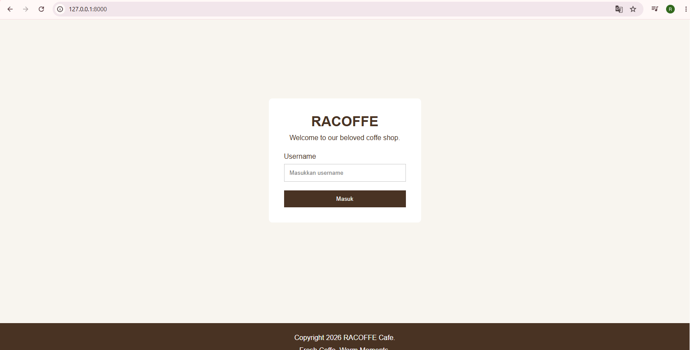
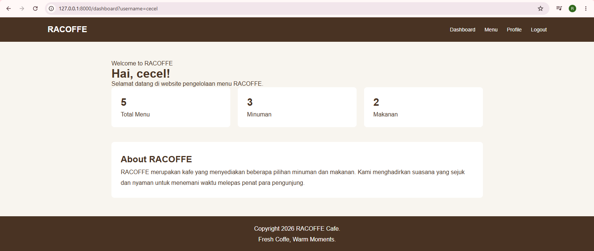
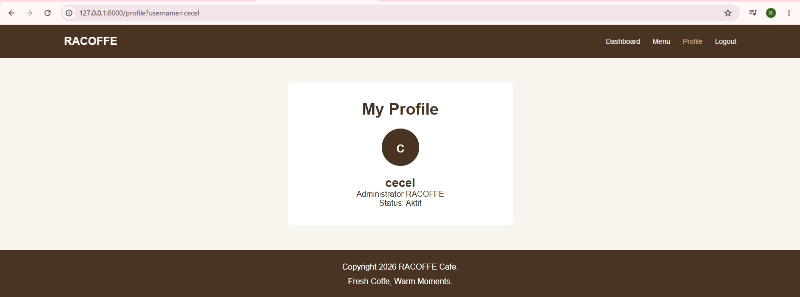
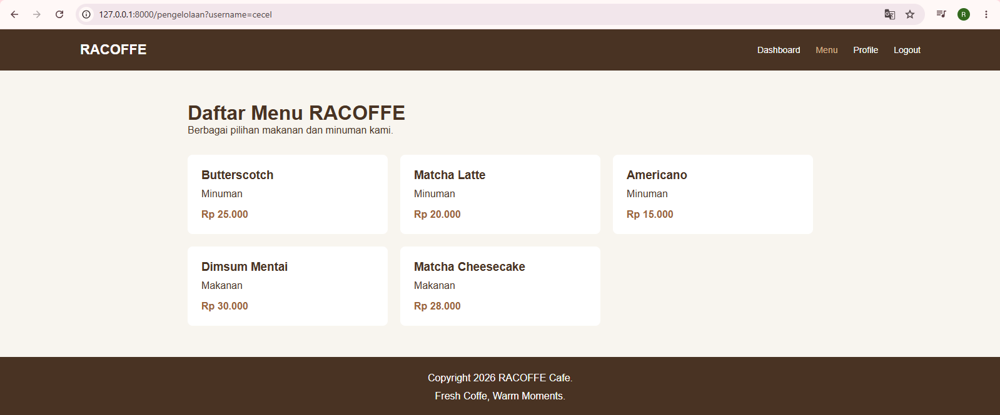

# RACOFE - Website Coffee Shop

Website RACOFE merupakan proyek Ujian Tengah Semester (UTS) mata kuliah Pemrograman Web. Website ini dibuat menggunakan Laravel 13 dengan tema coffee shop.

## Deskripsi Website

RACOFE merupakan website coffee shop sederhana yang memiliki fitur login, dashboard, profile, dan pengelolaan menu.

## Fitur Website

1. **Login** – Halaman untuk masuk ke website.
2. **Dashboard** – Halaman utama setelah login.
3. **Profile** – Menampilkan halaman profil pengguna.
4. **Pengelolaan Menu** – Menampilkan dan mengelola informasi menu kopi.

## Teknologi yang Digunakan

- Laravel 13
- PHP
- HTML
- CSS
- Blade Template

## Screenshot Website

### 1. Halaman Login

### 2. Halaman Dashboard

### 3. Halaman Profile

### 4. Halaman Pengelolaan Menu

## Identitas Mahasiswa

- NIM: 252410102028
- Mata Kuliah: Pemrograman Web
- Proyek: Ujian Tengah Semester (UTS)
- Nama Website: RACOFE